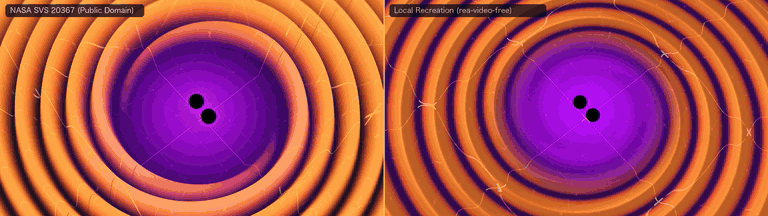
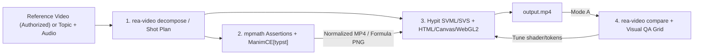

# rea-video-free

[](LICENSE)
[](https://agentskills.io/specification)
[](#cost--network-scope)
[](README.zh-CN.md)

An **Agent Skill** that guides AI coding assistants to inspect local reference videos, render verified mathematical animations, and assemble multi-track explainer videos locally using `rea-video`, `ManimCE`, and `Hypit`.

---

## Visual Showcases

### Showcase 1 (Mode A · Public-Domain Replication): Binary Black Hole Gravitational Waves



*Left: Excerpt from [NASA SVS 20367 — Gravitational Wave](https://svs.gsfc.nasa.gov/20367) (Public Domain · Credit: NASA's Goddard Space Flight Center Conceptual Image Lab; NASA does not endorse this project). Right: Pure-local recreation via `rea-video` analysis + WebGL2 spiral & warped spacetime grid rendered in Hypit (`0` cloud requests).*

> **Watch the full 12s side-by-side MP4:** [Compact in-repo preview (`1600×450`)](docs/nasa_gw_compare.mp4) · [Full-resolution `2560×720` MP4 (Release v2.0.0)](https://github.com/Tao-of-Sailing/rea-video-free/releases/download/v2.0.0/compare_nasa_gw_side_by_side.mp4)

### Showcase 2 (Mode B · 100% Original Editorial Explainer): Fourier Epicycles & Time–Frequency Duality


*100% original 12-second explainer authored with this skill (MIT-licensed with this repository): archival paper-grain title motion graphics (`Hypit`) → `mpmath`-verified 5-harmonic rotating epicycles (`ManimCE[typst]`) → split time–frequency spectrum card with pre-decoded `MathTypst` PNG and outlined bilingual subtitles. · [Watch full 12s MP4 with audio (Release v2.0.0)](https://github.com/Tao-of-Sailing/rea-video-free/releases/download/v2.0.0/output_editorial.mp4)*

---

## What It Does & What You Provide

This repository provides **workflow instructions (`SKILL.md`), helper scripts, templates, and a runnable minimal example**. It does not bundle external binaries (`rea-video`, `ManimCE`, `Hypit`, `FFmpeg`, or Chrome/Chromium), which are installed locally.

| Mode | What You Provide | What the Agent Produces |
|---|---|---|
| **A. Replicate a Reference Clip** | A local video you have rights/license to use + target time range | Shot breakdown (`VIDEO.md`), verified math animations (when needed), procedural HTML/WebGL/vector visuals, optional clean subtitles, and quantitative `rea-video compare` + visual grid reports |
| **B. Create an Original Explainer** | A topic/script outline, target resolution/fps, and local voiceover audio (`.wav`/`.mp3`, if narration is needed) | Shot timing plan, `mpmath` assertion tests, `ManimCE[typst]` clips, multi-track Hypit assembly with outlined subtitles, and visual storyboard review |

### Cost & Network Scope

- **Zero paid video-generation APIs:** Analysis and rendering run locally (`hypit plan` verified at 100% `Local requests`).
- **Separate costs:** Your AI coding assistant subscription/API usage and local CPU/GPU compute are separate.
- **Initial setup & audio:** Installing dependencies and optional models requires internet access; voiceover/TTS is not synthesized by this skill and must be supplied locally when needed.

---

## Supported AI Coding Agents

`SKILL.md` follows the open [Agent Skills specification (`agentskills.io`)](https://agentskills.io/specification). All compatible assistants can follow the same natural-language workflow instructions:

| AI Coding Assistant | Skill Standard | Verification Status | Install / Trigger Notes |
|---|---|---|---|
| **Antigravity** | `agentskills.io` `SKILL.md` | **Verified end-to-end** | Installed at `~/.gemini/config/skills/rea-video-free/` or `.agents/skills/rea-video-free/` |
| **Codex** | `agentskills.io` `SKILL.md` | Spec-compatible *(untested here)* | Consult OpenAI Codex skills documentation for directory & discovery paths |
| **Claude Code** | `agentskills.io` `SKILL.md` | Spec-compatible *(untested here)* | Consult Anthropic Claude Code skills documentation (or `npx skills add`) |
| **Cursor** | `agentskills.io` `SKILL.md` | Spec-compatible *(untested here)* | Consult Cursor rules/skills documentation for project & global placement |
| **Gemini CLI** | `agentskills.io` `SKILL.md` | Spec-compatible *(untested here)* | Consult Gemini CLI skills documentation for activation paths |
| **OpenCode** | `agentskills.io` `SKILL.md` | Spec-compatible *(untested here)* | Consult OpenCode agent skills documentation for workspace placement |

---

## Cross-Platform OS Support & Verification Matrix

Scripts and runtime templates are written to be cross-platform (`init_runtime.mjs` auto-detects Chrome/Chromium/Edge and `ffmpeg`/`ffprobe` across macOS, Linux, and Windows; CSS font stacks include macOS, Linux Noto/WenQuanYi, and Windows Microsoft YaHei/Segoe UI fallbacks). However, only Apple Silicon macOS has been run end-to-end here:

| Operating System | Tooling Readiness | End-to-End Verification Status |
|---|---|---|
| **macOS (Apple Silicon `26.6`, Apple M5)** | Homebrew `FFmpeg 9.0.2`, local Chrome, `Node.js v26.13.1`, Python `3.13` | **Verified end-to-end** (Showcases 1 & 2 + `examples/hypit_minimal/`) |
| **Linux (x64 / arm64)** | `init_runtime.mjs`, `qa_compare_grid.py` Noto CJK fallbacks, Bash quickstart | **Cross-platform scripts provided; unverified on Linux hardware** |
| **Windows (10 / 11)** | `init_runtime.mjs` `.exe`/registry-path lookup, YaHei/Segoe font fallbacks, PowerShell quickstart | **Cross-platform scripts provided; unverified on Windows hardware** |

---

## First-Time Quickstart

### 1. Install the Skill

**Universal installer (for supported clients):**
```bash
npx skills add https://github.com/Tao-of-Sailing/rea-video-free
```

**Manual clone (macOS / Linux Bash):**
```bash
git clone https://github.com/Tao-of-Sailing/rea-video-free.git
# Example for Antigravity global skills (check your agent's path if using Codex/Claude/Cursor/etc.):
mkdir -p ~/.gemini/config/skills
cp -R rea-video-free ~/.gemini/config/skills/rea-video-free
```

**Manual clone (Windows PowerShell):**
```powershell
git clone https://github.com/Tao-of-Sailing/rea-video-free.git
# Copy the folder into your coding agent's skills directory (e.g., .agents\skills\rea-video-free)
```

### 2. Local Tool Dependencies

| Tool | Tested Version (macOS) | Upstream Repository | Role |
|---|---|---|---|
| **FFmpeg / ffprobe** | `9.0.2` | [ffmpeg.org](https://ffmpeg.org/) | Trimming, audio generation, normalization, muxing |
| **rea-video** | `0.1.0` | [JuneYaooo/rea-video](https://github.com/JuneYaooo/rea-video) | Offline shot decomposition & foreground-mask comparison |
| **ManimCE + Typst** | `0.22.1` (`manim[typst]`), `mpmath 1.4.1`, `Pillow 13.0.0` | [ManimCommunity/manim](https://github.com/ManimCommunity/manim) | Numerically verified math plots & LaTeX-free `MathTypst` formulas |
| **Hypit + Chrome** | `@hypit/hypit 0.3.3`, `Node.js >= 22.15`, Google Chrome | [hypit-ai/hypit](https://github.com/hypit-ai/hypit) | `.svml`/`.svs` timeline, HTML/Canvas/WebGL2 visuals, CSS subtitles |

### 3. Verify With the Runnable Minimal Example

Test your local toolchain end-to-end inside [examples/hypit_minimal/](examples/hypit_minimal/):

<details open>
<summary><b>macOS / Linux (Bash / Zsh)</b></summary>

```bash
cd examples/hypit_minimal
npm install
node init_runtime.mjs          # auto-generates ./hypit.runtime.json for your OS
python3 generate_assets.py     # use your Python venv with manim[typst] & mpmath
npx hypit runtime use ./hypit.runtime.json
npx hypit doctor
npx hypit plan runs/final.svrun
npx hypit runtime up --endpoint media.local --endpoint html.local
npx hypit build runs/final.svrun --follow
rm -f output.mp4 && npx hypit get <build-id> --output final.video --to output.mp4
npx hypit runtime down
```

</details>

<details>
<summary><b>Windows (PowerShell)</b></summary>

```powershell
Set-Location examples\hypit_minimal
npm install
node init_runtime.mjs
python generate_assets.py
npx hypit runtime use .\hypit.runtime.json
npx hypit doctor
npx hypit plan runs\final.svrun
npx hypit runtime up --endpoint media.local --endpoint html.local
npx hypit build runs\final.svrun --follow
Remove-Item -Force -ErrorAction SilentlyContinue output.mp4
npx hypit get <build-id> --output final.video --to output.mp4
npx hypit runtime down
```

</details>

Expected output: `output.mp4` (`1280×720`, `25 fps`, `5.00s`, H.264 video + AAC stereo audio). See [examples/hypit_minimal/README.md](examples/hypit_minimal/README.md) for environment variable overrides (`HYPIT_CHROME_PATH`, `HYPIT_FFMPEG_PATH`, `HYPIT_FFPROBE_PATH`).

### 4. Example Prompts

Natural-language prompts work across all agents:

- **Mode A (Reference Replication):**
  > `Use the rea-video-free skill to inspect <path/to/reference.mp4>, recreate 00:00–00:12 with clean procedural visuals and subtitles, and run rea-video compare plus a visual QA grid.`
- **Mode B (Original Math / Signals Explainer):**
  > `Use the rea-video-free skill to produce a 12-second 1280x720 Fourier epicycles explainer with mpmath verification, ManimCE[typst] scenes, Hypit bilingual subtitles, and <path/to/voice.wav>.`

*(For agents supporting slash triggers, you can optionally prefix with `/rea-video-free`.)*

---

## How the Three Tools Coordinate



See **[Case Studies & Evaluation Details (docs/case-studies.md)](docs/case-studies.md)** for complete source attribution, WebGL2 shader vs ManimCE architecture notes, exact render timings, `rea-video compare` V1 → V6 metrics, and full-frame visual grids.

---

## License & Third-Party Notices

| Component | License | Terms & Important Notes |
|---|---|---|
| **This repository's original files** (`SKILL.md`, `scripts/`, `examples/`, Mode B showcase) | **[MIT](LICENSE)** | Grants permissions **only** for original authored files in this repo; grants no rights in third-party media. |
| **`rea-video`** | **Apache-2.0** | [JuneYaooo/rea-video](https://github.com/JuneYaooo/rea-video) — installed separately by the user. |
| **`Manim Community Edition`** | **MIT** | [ManimCommunity/manim](https://github.com/ManimCommunity/manim) — installed separately by the user. |
| **`Hypit` (`@hypit/hypit`)** | **Modified Apache-2.0** | [hypit-ai/hypit LICENSE](https://github.com/hypit-ai/hypit/blob/main/LICENSE) — **contains additional restrictions** on multi-tenant hosting, commercial redistribution, and certain UI branding/notices; permits internal and client projects on your own infrastructure and claims no rights over generated outputs. |
| **Showcase 1 Reference (`NASA SVS 20367`)** | **Public Domain (NASA Media Usage Guidelines)** | [svs.gsfc.nasa.gov/20367](https://svs.gsfc.nasa.gov/20367) — Credit: *NASA's Goddard Space Flight Center Conceptual Image Lab*. NASA does not endorse this repository or project. |

---

## Repository Structure

```text
rea-video-free/
├── SKILL.md                              # Core 4-phase workflow instructions (EN, agentskills.io)
├── README.md / README.zh-CN.md           # Bilingual documentation
├── references/
│   └── pitfalls-and-templates.md         # Cross-platform templates & verified engine pitfall fixes
├── scripts/
│   └── qa_compare_grid.py                # Multi-timestamp QA grids, storyboards & Pillow overlays
├── examples/
│   ├── math_core_example.py              # Standalone mpmath verification template
│   └── hypit_minimal/                    # Cross-platform 5s runnable Manim + Hypit + subtitles example
│       ├── init_runtime.mjs              # Auto-detects Chrome/FFmpeg/ffprobe across macOS/Linux/Win
│       └── hypit.runtime.example.json    # Runtime template
├── docs/
│   ├── case-studies.md / .zh-CN.md       # Benchmark specs, exact scores, and limitations
│   ├── hero_nasa_gw_compare.gif          # Showcase 1 (Mode A) animated comparison
│   ├── nasa_gw_compare.mp4               # Showcase 1 full 12s side-by-side MP4 (1600×450)
│   ├── nasa_gw_compare_grid.jpg          # Showcase 1 8-timestamp QA grid
│   ├── editorial_original_showcase.gif   # Showcase 2 (Mode B) animated explainer preview
│   └── editorial_original_storyboard.jpg # Showcase 2 8-timestamp storyboard
└── LICENSE                               # MIT License
```
