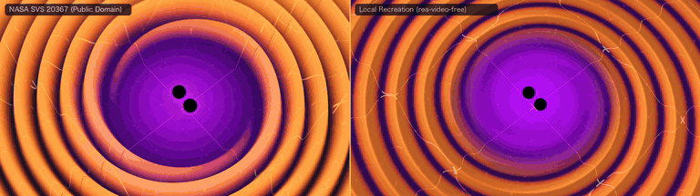
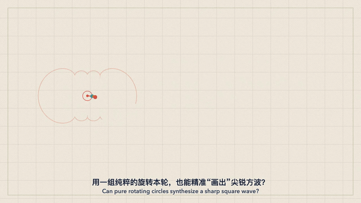

# rea-video-free

[](LICENSE)
[](https://agentskills.io/specification)
[](#费用与联网范围)
[](README.md)

这是一个面向 AI 编程助手的 **Agent Skill**，用于指导助手在本地协同调用 `rea-video`、`ManimCE` 与 `Hypit`，完成参考视频复刻或数学 / 信号与系统科普视频制作。

---

## 效果展示

### 案例一（模式 A · 公有领域高难度复刻）：双黑洞并合引力波



*左：[NASA SVS 20367 — Gravitational Wave](https://svs.gsfc.nasa.gov/20367) 原片截取（美国联邦政府公有领域 · Credit: NASA's Goddard Space Flight Center Conceptual Image Lab；NASA 不对本项目提供背书）。右：经 `rea-video` 离线分析后，通过 WebGL2 螺旋波场与扭曲时空网格在纯本地 Hypit 中完整复刻（`0` 次云端请求）。*

### 案例二（模式 B · 100% 原创杂志风科普）：傅里叶本轮与时频对偶



*基于本 Skill 从零原创的 12 秒科普短片（随本仓库以 MIT 协议开源）：开场纸纹动效与旋转本轮图标（`Hypit`）→ 经 `mpmath` 校验的五阶奇次谐波圆周叠加动画（`ManimCE[typst]`）→ 时域波形与 `1/n` 离散频谱双栏对照（内嵌 `MathTypst` 透明公式图 + 描边双语字幕）。*

---

## 能做什么与需要提供什么

本仓库提供的是**工作流指令（`SKILL.md`）、辅助脚本、模板与可运行最小示例**，不包含视频处理软件本体；使用前需在本地安装对应外部工具。

| 使用模式 | 你需要提供 | 助手最终产出 |
|---|---|---|
| **A. 复刻参考视频** | 你拥有合法使用/再创作权限的本地参考视频路径 + 目标时间段 | 分镜拆解报告（`VIDEO.md`）、数值校验后的数学片段（按需）、纯代码重绘的 HTML/WebGL2/矢量画面、可选干净字幕与 `rea-video compare` + 对比网格验收报告 |
| **B. 制作原创科普** | 主题或脚本大纲、目标分辨率/帧率、本地配音音频（`.wav`/`.mp3`，如需旁白） | 分镜时间表、`mpmath` 数学断言测试、`ManimCE[typst]` 数学片段、Hypit 多轨字幕合成成片与关键帧故事板检查 |

### 费用与联网范围

- **无需任何付费视频生成 API：** 拆解分析与渲染合成均在本地执行（`hypit plan` 验证 100% `Local requests`）。
- **其他独立成本：** AI 编程助手自身的订阅/接口费用与本机算力消耗另计。
- **首次装包与配音：** 首次安装工具及可选模型权重需要联网；本 Skill 不内置免费语音合成（TTS），需要配音时请提供本地音频文件。

---

## 支持的 AI 编程助手（同级适配）

`SKILL.md` 遵循开放的 [Agent Skills 规范（`agentskills.io`）](https://agentskills.io/specification)，所有兼容该规范的 AI 编程助手均可通过自然语言直接调用：

| AI 编程助手 | 技能规范 | 实测状态 | 安装与触发说明 |
|---|---|---|---|
| **Antigravity** | `agentskills.io` `SKILL.md` | **已端到端实测通过** | 全局目录 `~/.gemini/config/skills/rea-video-free/` 或项目 `.agents/skills/rea-video-free/` |
| **Codex** | `agentskills.io` `SKILL.md` | 规范兼容 *（本仓库未逐一实测）* | 请查阅 OpenAI Codex 官方文档中的 Skills 目录与触发方式 |
| **Claude Code** | `agentskills.io` `SKILL.md` | 规范兼容 *（本仓库未逐一实测）* | 请查阅 Anthropic Claude Code Skills 文档（或通过 `npx skills add` 安装） |
| **Cursor** | `agentskills.io` `SKILL.md` | 规范兼容 *（本仓库未逐一实测）* | 请查阅 Cursor 官方 Rules / Skills 目录配置说明 |
| **Gemini CLI** | `agentskills.io` `SKILL.md` | 规范兼容 *（本仓库未逐一实测）* | 请查阅 Gemini CLI Skills 发现路径说明 |
| **OpenCode** | `agentskills.io` `SKILL.md` | 规范兼容 *（本仓库未逐一实测）* | 请查阅 OpenCode 官方 Agent Skills 配置路径说明 |

---

## 跨平台操作系统支持与验证矩阵

仓库内的运行初始化脚本（`init_runtime.mjs` 自动检测 macOS / Linux / Windows 下的 Chrome/Chromium/Edge 与 `ffmpeg`/`ffprobe`）、字体回退栈（覆盖 macOS / Linux Noto 与文泉驿 / Windows 微软雅黑与 Segoe UI）以及 PowerShell 命令均已按跨平台设计；但目前**仅在 Apple Silicon macOS 上完成了端到端渲染实测**：

| 操作系统 | 跨平台准备情况 | 端到端渲染实测状态 |
|---|---|---|
| **macOS（Apple Silicon `26.6`, Apple M5）** | Homebrew `FFmpeg 9.0.2`、本地 Chrome、`Node.js v26.13.1`、Python `3.13` | **已端到端实测通过**（含案例一、案例二及 `examples/hypit_minimal/`） |
| **Linux（x64 / arm64）** | 已提供 `init_runtime.mjs` 自动探测、`qa_compare_grid.py` Noto CJK 字体回退与 Bash 步骤 | **已提供跨平台脚本，尚未在 Linux 实机验证** |
| **Windows（10 / 11）** | 已提供 `init_runtime.mjs` `.exe` 路径探测、微软雅黑字体回退与 PowerShell 步骤 | **已提供跨平台脚本，尚未在 Windows 实机验证** |

---

## 第一次使用（快速开始）

### 1. 安装 Skill

**通用命令行安装（适用于支持的客户端）：**
```bash
npx skills add https://github.com/Tao-of-Sailing/rea-video-free
```

**手动复制（macOS / Linux Bash）：**
```bash
git clone https://github.com/Tao-of-Sailing/rea-video-free.git
# 以 Antigravity 全局目录为例（若使用 Codex / Claude Code / Cursor 等，请放入对应客户端的 skills 目录）：
mkdir -p ~/.gemini/config/skills
cp -R rea-video-free ~/.gemini/config/skills/rea-video-free
```

**手动复制（Windows PowerShell）：**
```powershell
git clone https://github.com/Tao-of-Sailing/rea-video-free.git
# 将文件夹复制到你所用编程助手的 skills 目录（例如 .agents\skills\rea-video-free）
```

### 2. 本地工具依赖

| 工具 | 实测版本（macOS） | 上游仓库 | 职责 |
|---|---|---|---|
| **FFmpeg / ffprobe** | `9.0.2` | [ffmpeg.org](https://ffmpeg.org/) | 视频裁剪、本地测试音合成、规范化与混流 |
| **rea-video** | `0.1.0` | [JuneYaooo/rea-video](https://github.com/JuneYaooo/rea-video) | 离线切镜拆解与前景掩膜对比评分 |
| **ManimCE + Typst** | `0.22.1`（`manim[typst]`）、`mpmath 1.4.1`、`Pillow 13.0.0` | [ManimCommunity/manim](https://github.com/ManimCommunity/manim) | 数值校验数学曲线与免 LaTeX `MathTypst` 公式渲染 |
| **Hypit + Chrome** | `@hypit/hypit 0.3.3`、`Node.js >= 22.15`、Google Chrome | [hypit-ai/hypit](https://github.com/hypit-ai/hypit) | `.svml`/`.svs` 时间线、HTML/Canvas/WebGL2 动效与 CSS 描边字幕 |

### 3. 运行最小示例验证本地环境

开始正式项目前，先进入 [examples/hypit_minimal/](examples/hypit_minimal/) 跑通最小示例：

<details open>
<summary><b>macOS / Linux（Bash / Zsh）</b></summary>

```bash
cd examples/hypit_minimal
npm install
node init_runtime.mjs          # 自动探测本机 Chrome/ffmpeg/ffprobe 生成 ./hypit.runtime.json
python3 generate_assets.py     # 请使用已安装 manim[typst] 和 mpmath 的 Python 环境
npx hypit runtime use ./hypit.runtime.json
npx hypit doctor
npx hypit plan runs/final.svrun
npx hypit runtime up --endpoint media.local --endpoint html.local
npx hypit build runs/final.svrun --follow
rm -f output.mp4 && npx hypit get <build-id> --output final.video --to output.mp4
npx hypit runtime down
```

</details>

<details>
<summary><b>Windows（PowerShell）</b></summary>

```powershell
Set-Location examples\hypit_minimal
npm install
node init_runtime.mjs
python generate_assets.py
npx hypit runtime use .\hypit.runtime.json
npx hypit doctor
npx hypit plan runs\final.svrun
npx hypit runtime up --endpoint media.local --endpoint html.local
npx hypit build runs\final.svrun --follow
Remove-Item -Force -ErrorAction SilentlyContinue output.mp4
npx hypit get <build-id> --output final.video --to output.mp4
npx hypit runtime down
```

</details>

预期生成 `output.mp4`（`1280×720`、`25 fps`、`5.00s`，含 H.264 视频轨与 AAC 立体声音频轨）。环境变量覆盖说明见 [examples/hypit_minimal/README.md](examples/hypit_minimal/README.md)。

### 4. 示例提示词

自然语言在所有兼容助手上均可直接使用：

- **模式 A（复刻本地视频）：**
  > `请按 rea-video-free 工作流检查本地视频 <参考视频路径>，使用纯代码动效与双语字幕复刻 00:00–00:12，并输出 rea-video compare 与多时刻视觉对比网格。`
- **模式 B（制作原创数学/信号科普）：**
  > `请用 rea-video-free 制作一段 12 秒 1280x720 的傅里叶本轮科普视频，先做 mpmath 数值校验，再用 ManimCE[typst] 与 Hypit 合成双语描边字幕并混入 <音频路径/voice.wav>。`

*（若所使用的客户端支持斜杠命令，也可在句首加上可选的 `/rea-video-free`。）*

---

## 三工具流水线协作关系


详细来源说明、WebGL2 / ManimCE 技术架构、实测渲染耗时、`rea-video compare` 迭代曲线与高清网格图请见 **[案例研究与评测明细（docs/case-studies.zh-CN.md）](docs/case-studies.zh-CN.md)**。

---

## 开源协议与第三方声明

| 组成部分 | 许可证 / 授权状态 | 条款与重要说明 |
|---|---|---|
| **本仓库原创文件**（`SKILL.md`、脚本、示例、案例二原创成片与展示图） | **[MIT](LICENSE)** | 仅适用于本仓库作者原创代码与素材；**不授予**任何第三方媒体文件的版权许可。 |
| **`rea-video`** | **Apache-2.0** | [JuneYaooo/rea-video](https://github.com/JuneYaooo/rea-video) — 需由用户自行本地安装。 |
| **`Manim Community Edition`** | **MIT** | [ManimCommunity/manim](https://github.com/ManimCommunity/manim) — 需由用户自行本地安装。 |
| **`Hypit`（`@hypit/hypit`）** | **Modified Apache-2.0** | [hypit-ai/hypit LICENSE](https://github.com/hypit-ai/hypit/blob/main/LICENSE) — **含附加限制条款**：限制将其作为多租户托管服务对外提供、部分商业再分发及特定 UI 标识要求；允许在自有基础设施上用于内部及客户项目，且不对其生成成片主张权利。 |
| **案例一参考原片（`NASA SVS 20367`）** | **Public Domain（NASA 媒体使用指南）** | [svs.gsfc.nasa.gov/20367](https://svs.gsfc.nasa.gov/20367) — 署名：*NASA's Goddard Space Flight Center Conceptual Image Lab*。NASA 未对本仓库或本项目作任何背书。 |

---

## 仓库目录结构

```text
rea-video-free/
├── SKILL.md                              # 核心四阶段工作流指令（agentskills.io 规范）
├── README.md / README.zh-CN.md           # 中英双语说明文档
├── references/
│   └── pitfalls-and-templates.md         # 跨平台配置模板与实测避坑手册
├── scripts/
│   └── qa_compare_grid.py                # 多时刻对比网格、故事板与 Pillow 标签生成脚本
├── examples/
│   ├── math_core_example.py              # 独立 mpmath 数值断言模板
│   └── hypit_minimal/                    # 跨平台可运行的 5 秒 Manim + Hypit + 字幕最小示例
│       ├── init_runtime.mjs              # 自动探测 macOS/Linux/Win Chrome/FFmpeg/ffprobe
│       └── hypit.runtime.example.json    # 运行时配置模板
├── docs/
│   ├── case-studies.md / .zh-CN.md       # 案例指标、耗时与局限性说明（中英）
│   ├── hero_nasa_gw_compare.gif          # 案例一（模式 A）首屏并排对比动图
│   ├── nasa_gw_compare_grid.jpg          # 案例一 8 时刻对比网格图
│   ├── editorial_original_showcase.gif   # 案例二（模式 B）原创科普预览动图
│   └── editorial_original_storyboard.jpg # 案例二 8 时刻关键帧故事板
└── LICENSE                               # MIT 协议
```
