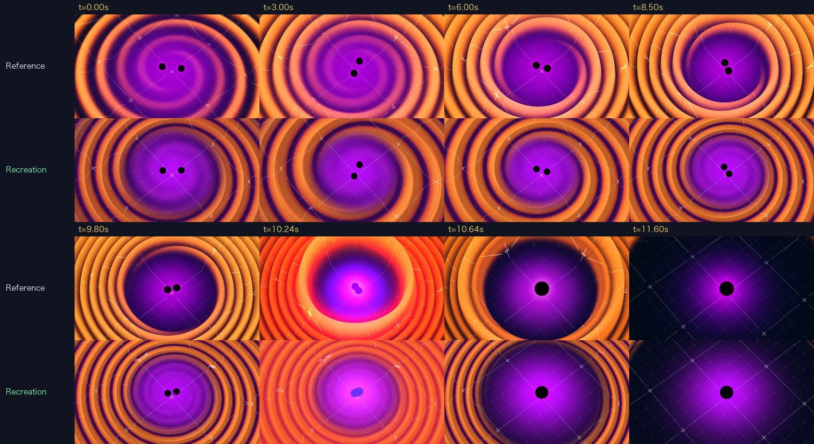
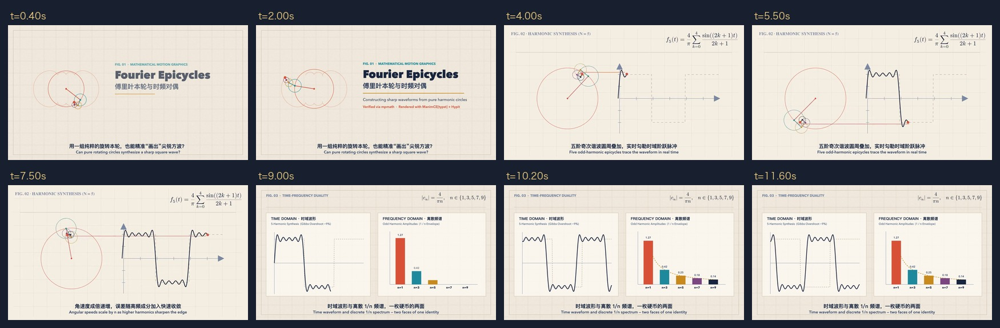

# Case Studies & Evaluation Details

> **Environment Scope:** All builds and measurements below were executed locally on **macOS `26.6` (Apple M5)** using `FFmpeg 9.0.2`, `rea-video 0.1.0`, `ManimCE 0.22.1` (`manim[typst]`), `mpmath 1.4.1`, `Pillow 13.0.0`, `Node.js v26.13.1`, `@hypit/hypit 0.3.3`, and local Google Chrome. **Zero paid video-generation APIs or cloud Hypit providers were invoked (`0` cloud requests).**

---

## Case 1 (Mode A · Public-Domain Replication): NASA SVS 20367 *Gravitational Wave*

**Full 12s Side-by-Side Comparison Video:** [Compact `1600×450` MP4 (in-repo)](nasa_gw_compare.mp4) · [Full `2560×720` MP4 (Release v2.0.0)](https://github.com/Tao-of-Sailing/rea-video-free/releases/download/v2.0.0/compare_nasa_gw_side_by_side.mp4)

### Source Attribution & Window Specification

- **Reference Work:** *Gravitational Wave* — [NASA Scientific Visualization Studio ID 20367](https://svs.gsfc.nasa.gov/20367)
- **License Status:** Public Domain under [NASA Media Usage Guidelines](https://www.nasa.gov/nasa-brand-center/images-and-logos/)
- **Credit:** *NASA's Goddard Space Flight Center Conceptual Image Lab* (Animator: Krystofer Kim; Producer: Scott Wiessinger; Science Writer: Jeanette Kazmierczak; Scientists: James Ira Thorpe, Bernard J. Kelly). *NASA does not endorse this project.*
- **Source File Trimmed:** `A_Gravitational_Wave_h264.mp4` (`3840×2160`, `30 fps`, `35.07s`) → trimmed `00:16.00–00:28.00` (`12.00s`) and normalized to **`1280×720`, `25 fps`, `yuv420p` (`300` frames)** as `ref_gw.mp4`.
- **Story Span Covered:** Late inspiral chirp (`0–10.1s`) → crimson–magenta–violet peanut horizon merger (`t ≈ 10.24s`) → outward-propagating burst clearing (`10.3–11.5s`) → calm purple remnant halo & unwarped lattice (`11.6–12.0s`).

### Offline Analysis Findings (`rea-video decompose`, No VLM)

Running `rea-video decompose ref_gw.mp4 -o analysis/` completed in `5.5s` (offline heuristics only, `--vlm` omitted). Without visual inspection, offline pixel classifiers misidentified the glowing bokeh wave gradients and bright lattice `+` crosshairs as `live_action (48%)` with `花字 6 处` / `文字标注 14 处` (`「X」、「十」、「t」`). Inspecting `analysis/storyboard.jpg` and full-res frames immediately revealed a procedural CG quadrupole heightfield + 3D perspective coordinate grid — confirming why **`SKILL.md` mandates visual inspection before choosing an asset pipeline**.

### Quantitative Measurement & Procedural Recreation

Using `PIL`/`numpy` on `ref_gw.mp4`:
1. Extracted binary center `(675, 362)`, frame-by-frame unwrapped orbital chirp angle $\theta(t)$ (`t=0..10.08s`, `127` keyframes), separation $d(t)$ (`131.7 px → 59.9 px`), and perspective orbital aspect ratio (`0.89`).
2. Solved a `3×3` planar lattice homography across 7 detected major `+` crosshairs (`1.14 px` RMSE).
3. Implemented a custom Hypit `@hypit/html-program` WebGL2 GLSL fragment shader (`gw-visual@1`) combining:
   - Retarded-time quadrupole wave heightfield with upper-left directional derivative embossing,
   - Smooth metaball (`smin`) horizon coalescence into the `t ≈ 10.24s` peanut burst,
   - Outward radial wave clearing front at $v_{\text{sweep}} \approx 0.94$ lattice units/s, and
   - Major/minor `+` coordinate grid warped proportionally to the active wave envelope `env`.

### Measured `rea-video compare` Iteration Log (`--every 0.25`)

All builds ran 100% locally via `html.local` + `media.local` (`3/3 Local requests`, ~`9–12s` rasterization per 300-frame build on Apple M5):

| Iteration | Focus Change | `score` | `place` | `shape` |
|---|---|---|---|---|
| **V1** | Baseline WebGL2 shader, `wave-speed=0.56` | `0.639` | `0.681` | `0.562` |
| **V2** | Calibrated `sweep-speed=0.94`, `wave-speed=0.92`, brighter crest | `0.679` | `0.726` | `0.586` |
| **V3** | Strain-weighted coral-to-tangerine ramp (over-dimmed post-merger halo) | `0.636` | `0.671` | `0.541` |
| **V4** | Fixed post-merger halo persistence & wave-envelope-only grid warp | `0.671` | `0.699` | `0.552` |
| **V5** | Nonlinear radial phase ramp (`vEff: 0.44 → 0.82`) | `0.693` | `0.736` | `0.576` |
| **V6 (Selected)** | Sharper crest-vs-trough contrast (`pow 0.78`), deeper plum trough & calmer peak brightness | **`0.695`** | **`0.740`** | **`0.575`** |

### Honest Metric Limitations

- `rea-video compare` segments a binary foreground mask per frame (`shape` IoU + `place` overlap + lab color distance). On continuous 3D-embossed radial plasma gradients covering almost 100% of the frame, minor crest-edge brightness or phase differences shift the threshold boundary and keep `shape` around `0.575`, even when frame-by-frame visual alignment in [nasa_gw_compare_grid.jpg](nasa_gw_compare_grid.jpg) is close.
- No audio track accompanies SVS 20367's silent visualization clip; Hypit's `media.local` muxed a silent stereo frame-aligned audio container.

---

## Case 2 (Mode B · 100% Original Explainer): *Fourier Epicycles & Time–Frequency Duality*

**Full 12s Output MP4 (with audio):** [Download / Watch `1280×720` MP4 (Release v2.0.0)](https://github.com/Tao-of-Sailing/rea-video-free/releases/download/v2.0.0/output_editorial.mp4)

### Design & Specifications

- **Authorship & License:** 100% original code, math, visuals, and storyboard authored directly with `rea-video-free` (MIT-licensed with this repository).
- **Target Spec:** **`1280×720`, `25 fps`, `12.00s` (`300` frames exact)** with archival warm-cream editorial palette (`#F5EFE4` paper background, `#18253F` Oxford navy ink, `#D95238` vermilion, `#1F8A9C` teal, `#C98A1E` gold).
- **Audio & Subtitles:** Purely local harmonic A-major ambient chord (`ffmpeg lavfi` `48 kHz` stereo WAV) + Hypit CSS outlined bilingual subtitles at `z=100` across all 3 shots.

### Three-Shot Cross-Tool Architecture

| Window | Frames | Stage / Tool | Implementation Details |
|---|---|---|---|
| **Shot 1 (`0.0s–3.6s`)** | `0–89` | **Hypit `htmlVisual`** | Procedural `256×256` paper grain (`multiply`), blueprint grid, animated 4-harmonic rotating phasor emblem with cycloid trail, bilingual magazine title layout |
| **Shot 2 (`3.6s–8.6s`)** | `90–214` | **ManimCE + Typst + `mpmath`** | Subtitle-free `FourierEpicyclesScene`: 5 nested rotating circles ($n=1,3,5,7,9$) tracing the Gibbs-ringing square wave in real time alongside `MathTypst` equation (`5.00s` exact clip via `ffmpeg`) |
| **Shot 3 (`8.6s–12.0s`)** | `215–299` | **Hypit `htmlVisual` + Typst PNG** | Side-by-side archival cards showing oscillating time-domain partial sum vs. animated $1/n$ discrete harmonic bars with golden envelope & pre-decoded base64 `MathTypst` formula PNG |

### Verification & Render Summary

- **Mathematical Verification (`math_core.py`, `mp.dps = 25`):** Asserted odd symmetry at $t=0,\pi$, exact 5-term rational value at $t=\pi/2$, and Parseval's energy identity $\frac{1}{2\pi}\int_0^{2\pi} f_5(t)^2\,dt = \frac{8}{\pi^2}\sum_{k=0}^4 (2k+1)^{-2} \approx 0.95960479$ (`error < 1e-18`).
- **Hypit Plan & Build:** `hypit plan runs/final.svrun` confirmed **`7/7 Local requests` (`0` cloud)**. Final `output_editorial.mp4` verified via `ffprobe` (`1280×720`, `25/1 fps`, `12.00s`, H.264 + AAC stereo, `1.06 MB`) and inspected visually across all 8 storyboard timestamps in [editorial_original_storyboard.jpg](editorial_original_storyboard.jpg).
