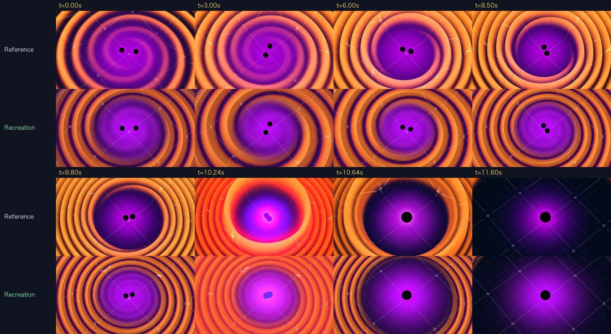
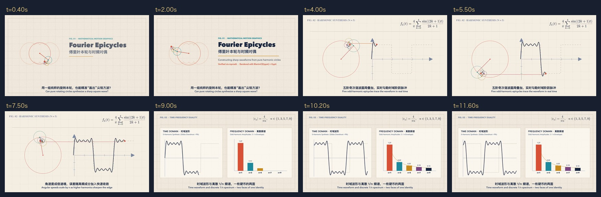

# 案例研究与评测明细

> **实测环境声明：** 以下全部构建与评测均在 **macOS `26.6`（Apple M5）** 本地执行，工具版本为 `FFmpeg 9.0.2`、`rea-video 0.1.0`、`ManimCE 0.22.1`（`manim[typst]`）、`mpmath 1.4.1`、`Pillow 13.0.0`、`Node.js v26.13.1`、`@hypit/hypit 0.3.3` 与本地 Google Chrome。**全程零付费视频生成 API、零云端 Hypit 调用（`0` 次云端请求）。**

---

## 案例一（模式 A · 公有领域高难度复刻）：NASA SVS 20367《双黑洞引力波》

**完整 12 秒并排对比视频：** [仓库内轻量版 `1600×450` MP4](nasa_gw_compare.mp4) · [原画质 `2560×720` MP4（Release v2.0.0）](https://github.com/Tao-of-Sailing/rea-video-free/releases/download/v2.0.0/compare_nasa_gw_side_by_side.mp4)

### 参考出处与时间窗口口径

- **参考作品：** *Gravitational Wave* — [NASA 科学可视化工作室（SVS）编号 20367](https://svs.gsfc.nasa.gov/20367)
- **版权状态：** 美国联邦政府公有领域，遵循 [NASA 媒体使用指南](https://www.nasa.gov/nasa-brand-center/images-and-logos/)
- **官方署名：** *NASA's Goddard Space Flight Center Conceptual Image Lab*（Animator: Krystofer Kim; Producer: Scott Wiessinger; Science Writer: Jeanette Kazmierczak; Scientists: James Ira Thorpe, Bernard J. Kelly）。*NASA 未对本项目提供任何背书。*
- **截取区间：** 官方 4K 原片 `A_Gravitational_Wave_h264.mp4`（`3840×2160`、`30 fps`、`35.07s`）截取 **`00:16.00–00:28.00`（`12.00s`）**，统一归一化至 **`1280×720`、`25 fps`、`yuv420p`（`300` 帧）**作为参考基准 `ref_gw.mp4`。
- **物理剧情：** 旋进啁啾加速（`0–10.1s`）→ 红紫闪烁花生状视界并合（`t ≈ 10.24s`）→ 冲击波径向扫出清场（`10.3–11.5s`）→ 平静紫光余晖黑洞与复原坐标网格（`11.6–12.0s`）。

### 离线分析误判与视觉复核实录（`rea-video decompose`，未开启 VLM）

执行 `rea-video decompose ref_gw.mp4 -o analysis/` 耗时 `5.5s`（仅离线启发式统计，未传 `--vlm`）。在未看图前，离线像素启发式把高饱和柔光波纹和网格白色 `+` 十字准星误判为 `live_action（48%）` 并识别出 `花字 6 处` / `文字标注 14 处`（`「X」、「十」、「t」`）。直接查阅 `analysis/storyboard.jpg` 与原分辨率截图后即可确认其为程序化四极引力波高度场 + 3D 透视坐标网格——这也直观印证了 **`SKILL.md` 强制先人工/视觉看图再制定资产策略**的必要性。

### 像素测绘与纯代码重建细节

通过 `PIL`/`numpy` 对 `ref_gw.mp4` 进行实测：
1. 测量得到黑洞轨道中心 `(675, 362)`、逐帧解包裹啁啾角速度曲线 $\theta(t)$（`t=0..10.08s`，`127` 个关键节点）、双星间距衰减 $d(t)$（`131.7 px → 59.9 px`）以及 3D 视角纵向压缩比 `0.89`。
2. 基于 7 个主网格 `+` 交点求解 `3×3` 平面单应矩阵（重投影 RMSE 为 `1.14 px`）。
3. 在纯本地 Hypit `@hypit/html-program` 中编写自定义 WebGL2 GLSL 片元着色器（`gw-visual@1`）：
   - 依据推迟时间 $t_{\text{emit}} = t - r / v_{\text{eff}}(t)$ 构建双臂四极螺旋高度场，并利用空间有限差分法线实现左上方浮雕光照；
   - 使用光滑最小值（`smin`）在 `t ≈ 10.24s` 实现双视界拉伸为花生形并与红紫闪光同步融合；
   - 并合后以 $v_{\text{sweep}} \approx 0.94$ 格/秒向外清扫波前；
   - 主/次级 `+` 坐标网格仅在波包 `env` 有效区间内随波起伏，波浪退去后自然恢复笔直。

### `rea-video compare` 实测迭代曲线（`--every 0.25`）

全部版本均由本地 `html.local` + `media.local` 执行（`3/3 Local requests`，单次 300 帧光栅化耗时约 `9–12s`）：

| 迭代版本 | 核心调整 | `score` | `place` | `shape` |
|---|---|---|---|---|
| **V1** | 初版 WebGL2 着色器，`wave-speed=0.56` | `0.639` | `0.681` | `0.562` |
| **V2** | 校准波速与扫出速度 `wave-speed=0.92 / sweep-speed=0.94`，提亮波峰 | `0.679` | `0.726` | `0.586` |
| **V3** | 应变加权玫瑰-橘红渐变（并合后中心紫晕衰减过快导致尾段扣分） | `0.636` | `0.671` | `0.541` |
| **V4** | 修复并合后中心紫晕保持与网格仅随波包扭曲 | `0.671` | `0.699` | `0.552` |
| **V5** | 校准非线性径向相速度曲线（`vEff: 0.44 → 0.82`） | `0.693` | `0.736` | `0.576` |
| **V6（定稿）** | 提高波峰波谷对比度（`pow 0.78`），加深紫红波谷并校准峰高色相 | **`0.695`** | **`0.740`** | **`0.575`** |

### 评测指标局限性说明

- `rea-video compare` 通过逐帧二值化提取前景区域计算 `shape` 交并比（IoU）、位置重叠（`place`）与 Lab 色差。对于铺满全屏的连续 3D 浮雕渐变等离子体波纹，极微小的明暗阈值漂移都会在二值化后放大 `shape` 掩膜边界差异，因此即便在 [nasa_gw_compare_grid.jpg](nasa_gw_compare_grid.jpg) 中逐帧视觉与轨迹高度吻合，`shape` 仍停留在 `0.575` 左右（低于离散矢量几何画面的常见分值）。
- NASA SVS 20367 原片无配音音轨，合成成片内由本地 `media.local` 封装标准空白立体声音轨对齐时长。

---

## 案例二（模式 B · 100% 原创杂志风科普）：《傅里叶本轮与时频对偶》

**完整 12 秒原创成片（含和弦音频）：** [查看/下载 `1280×720` MP4（Release v2.0.0）](https://github.com/Tao-of-Sailing/rea-video-free/releases/download/v2.0.0/output_editorial.mp4)

### 创作架构与规格

- **原创归属与协议：** 代码、数值断言、图形资产与三镜头分镜全部为本项目 100% 原创（随本仓库以 MIT 协议发布）。
- **成片规格：** **`1280×720`、`25 fps`、`12.00s`（精确 `300` 帧）**，全片采用统一档案馆米白纸面 `#F5EFE4`、牛津藏青主墨色 `#18253F`、朱红 `#D95238`、青绿 `#1F8A9C` 与古铜金 `#C98A1E` 杂志视觉规范。
- **音频与字幕：** 通过 `ffmpeg lavfi` 纯本地合成温和 A 大调和弦音频（`48 kHz` 立体声 WAV），并由 Hypit 在 `z=100` 轨道叠加带浅米白描边护圈的双语字幕。

### 三镜头跨工具协作拆解

| 时间窗口 | 帧范围 | 负责阶段 | 实现细节 |
|---|---|---|---|
| **Shot 1（`0.0s–3.6s`）** | `0–89` | **Hypit `htmlVisual`** | 程序化 `256×256` 纸纹（`multiply` 叠加）、制图底纹网格、4 阶本轮动态摆线徽标与杂志风双语主标题排版 |
| **Shot 2（`3.6s–8.6s`）** | `90–214` | **ManimCE + Typst + `mpmath`** | 无字幕 `FourierEpicyclesScene`：五阶奇次谐波圆周（$n=1,3,5,7,9$）实时联动右侧绘制吉布斯方波及 `MathTypst` 级数公式（经 `ffmpeg` 归一化为精确 `5.00s`） |
| **Shot 3（`8.6s–12.0s`）** | `215–299` | **Hypit `htmlVisual` + Typst PNG** | 左右分栏卡片对比：左侧实时局部和方波与吉布斯过冲，右侧随动画升起的 $1/n$ 离散谐波频谱柱状图与金色双曲包络线，右上角内嵌预解码 base64 `MathTypst` 公式 PNG |

### 数值与成片验证结果

- **数学断言（`math_core.py`，精度 `mp.dps = 25`）：** 验证了 $t=0,\pi$ 处奇对称零点、$t=\pi/2$ 五阶部分和解析值以及帕塞瓦尔（Parseval）能量恒等式 $\frac{1}{2\pi}\int_0^{2\pi} f_5(t)^2\,dt = \frac{8}{\pi^2}\sum_{k=0}^4 (2k+1)^{-2} \approx 0.95960479$（误差 `< 1e-18`）。
- **Hypit 构建验收：** `hypit plan runs/final.svrun` 确认 **`7/7 Local requests`（`0` 次云端请求）**；`ffprobe` 校验成片为 `1280×720`、`25/1 fps`、`12.00s`（H.264 + AAC 立体声，`1.06 MB`），8 时刻视觉检查结果见 [editorial_original_storyboard.jpg](editorial_original_storyboard.jpg)。
